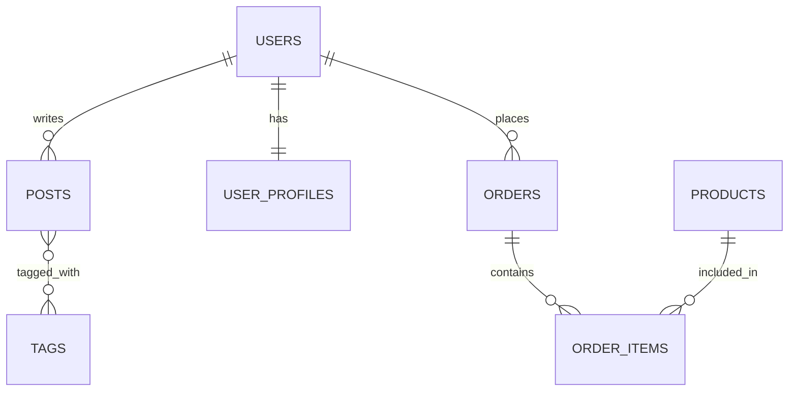

# Analyse Codebase Workflow

## Purpose
Systematically analyse an existing codebase to produce a full set of reverse-engineered documentation. This is essential when onboarding to an unfamiliar project, preparing for a major refactor, migrating ownership, or enabling an AI assistant to work effectively on the codebase.

## Prerequisites
- The codebase is accessible and can be read in its entirety.
- The application can be run locally (preferred) or screenshots/recordings are available.
- Access to the database (or migration files / ORM schema) for schema analysis.

## Output Structure
All deliverables are written to a `reverse-engineering/` directory at the project root:

```
reverse-engineering/
├── design/
│   ├── backend-architecture.md        # Backend design document
│   ├── frontend-architecture.md       # UI/UX design document (if frontend exists)
│   └── database-architecture.md       # Database design document
├── api-documentation.md               # Detailed API reference
├── user-manual.md                     # End-user manual
└── model-context.md                   # AI persistent memory for the project
```

---

## Phase 1 — Discovery & Inventory

### 1.1 Project Fingerprinting
Scan the project root to identify:

- **Package manager & lock file:** `package.json`, `pnpm-lock.yaml`, `poetry.lock`, `requirements.txt`, `go.mod`, etc.
- **Framework:** Next.js (`next.config`), React (`react-dom`), Vue, Angular, Express, Fastify, FastAPI, Django, etc.
- **Language:** TypeScript (`tsconfig.json`), JavaScript, Python, Go, etc.
- **Database:** Prisma (`prisma/schema.prisma`), Drizzle, SQLAlchemy, TypeORM, Knex, raw SQL migrations.
- **ORM / Query builder:** identify from dependencies and config files.
- **Testing:** Vitest, Jest, Playwright, Cypress, pytest — check `package.json` scripts and config files.
- **CI/CD:** `.github/workflows/`, `.gitlab-ci.yml`, `Dockerfile`, `docker-compose.yml`.
- **Environment:** `.env.example`, `.env.local`, environment validation files.

Record findings in a scratchpad for use across all subsequent phases.

### 1.2 Directory Structure Map
Produce a complete annotated directory tree (depth 3–4):

```markdown
## Directory Structure
project-root/
├── src/                    # Application source code
│   ├── app/                # [Next.js App Router / main entry]
│   ├── components/         # [Shared UI components]
│   ├── lib/                # [Utilities, helpers, constants]
│   ├── server/             # [Backend: routes, services, middleware]
│   └── ...
├── prisma/                 # [Database schema & migrations]
├── tests/                  # [Test suites]
├── public/                 # [Static assets]
└── ...
```

Annotate each directory with its **purpose** based on file contents, not just naming conventions.

### 1.3 Dependency Inventory
Extract and categorize all dependencies:

| Category | Package | Version | Purpose |
|----------|---------|---------|---------|
| Framework | next | 15.x | React meta-framework (SSR, RSC, routing) |
| UI Library | @radix-ui/react-dialog | 1.x | Accessible dialog primitive |
| Styling | tailwindcss | 3.x | Utility-first CSS |
| State | @tanstack/react-query | 5.x | Server state management |
| Validation | zod | 3.x | Schema validation |
| ORM | prisma | 5.x | Database ORM |
| Auth | next-auth | 5.x | Authentication |
| Testing | vitest | 1.x | Unit test runner |
| ... | ... | ... | ... |

Flag outdated dependencies (> 6 months behind latest) and known vulnerabilities.

---

## Phase 2 — Backend Architecture Analysis

### 2.1 Entry Points & Routing
- Identify the server entry point(s): Express `app.ts`, Next.js API routes (`app/api/`), FastAPI `main.py`, etc.
- Map **every route**: method, path, middleware chain, handler function, authentication requirement.
- Identify route grouping / namespacing patterns (e.g., `/api/v1/...`).

### 2.2 Layered Architecture Mapping
Trace the code flow from route → controller → service → repository → database:

```markdown
### Request Flow
Route definition
  → Middleware chain (auth, validation, rate-limit, etc.)
    → Controller / Handler (request parsing, response formatting)
      → Service (business logic)
        → Repository / Data Access (DB queries)
          → Database
```

For each layer, document:
- **Location:** file paths and directories.
- **Pattern:** how the layer is structured (classes, functions, modules).
- **Conventions:** naming, file organization, export patterns.
- **Dependencies:** what each layer imports from other layers.

### 2.3 Authentication & Authorization
- Identify the auth mechanism: JWT, session, OAuth, API keys, or combination.
- Map the auth flow: login → token issuance → token verification → refresh → logout.
- Document where auth middleware is applied (global, per-route, per-group).
- Identify authorization model: RBAC, ABAC, resource-level ownership checks.
- List all roles and permissions defined in the system.

### 2.4 Middleware & Cross-Cutting Concerns
Document every middleware in execution order:

| Order | Middleware | File | Purpose |
|-------|-----------|------|---------|
| 1 | requestId | `middleware/request-id.ts` | Assigns UUID to each request |
| 2 | logger | `middleware/logger.ts` | Structured request/response logging |
| 3 | cors | `middleware/cors.ts` | CORS policy enforcement |
| 4 | helmet | `middleware/security.ts` | Security headers |
| 5 | rateLimit | `middleware/rate-limit.ts` | Rate limiting |
| 6 | authenticate | `middleware/auth.ts` | JWT/session verification |
| 7 | validate | `middleware/validate.ts` | Schema validation |
| 8 | errorHandler | `middleware/error-handler.ts` | Global error handling |

### 2.5 Error Handling Strategy
- Identify custom error classes or error factories.
- Document how operational vs programmer errors are handled.
- Map the error response format: `{ error: { code, message, details } }` or other.
- Identify global error handlers, uncaught exception handlers, unhandled rejection handlers.

### 2.6 External Integrations
List all third-party services and APIs the backend communicates with:

| Service | Purpose | Client Location | Auth Method | Retry/Timeout |
|---------|---------|-----------------|-------------|----------------|
| Stripe | Payments | `lib/stripe.ts` | API key | 3 retries, 10s timeout |
| SendGrid | Email | `lib/email.ts` | API key | 2 retries, 5s timeout |
| S3 | File storage | `lib/storage.ts` | IAM role | 3 retries, 30s timeout |

### 2.7 Background Jobs & Queues
- Identify any job queue system (BullMQ, Celery, cron jobs).
- Document each job: name, trigger, schedule, handler, retry policy.

### 2.8 Write `reverse-engineering/design/backend-architecture.md`
Compile all findings into the backend design document using this template:

```markdown
# Backend Architecture — [Project Name]

> Reverse-engineered on YYYY-MM-DD from commit [short SHA].

## Overview
[One paragraph: what the backend does, which framework, language, hosting.]

## Tech Stack
| Layer | Technology | Version |
|-------|-----------|---------|
| Runtime | Node.js | 20.x |
| Framework | Express / Next.js API | x.x |
| Language | TypeScript (strict) | 5.x |
| ORM | Prisma | 5.x |
| Auth | JWT + refresh tokens | — |
| Queue | BullMQ | x.x |

## Directory Structure
[Annotated tree from Phase 1]

## Architecture Pattern
[Layered / Hexagonal / Monolith / Microservices — describe the pattern found]

## Request Flow Diagram
[Mermaid sequence diagram or textual flow]

## Route Inventory
| Method | Path | Auth | Middleware | Handler | Description |
|--------|------|------|-----------|---------|-------------|
| GET | /api/v1/users | Bearer | validate, paginate | UsersController.list | List users |
| POST | /api/v1/users | Bearer (admin) | validate | UsersController.create | Create user |
| ... | ... | ... | ... | ... | ... |

## Authentication & Authorization
[Auth mechanism, flow diagram, roles, permissions]

## Middleware Stack
[Ordered middleware table from 2.4]

## Error Handling
[Error classes, response format, global handler]

## External Integrations
[Table from 2.6]

## Background Jobs
[Job inventory from 2.7]

## Configuration & Environment
[Environment variables found in .env.example or validation schema]

## Identified Patterns & Conventions
- [Convention 1]
- [Convention 2]

## Identified Technical Debt & Risks
| Issue | Severity | Location | Recommendation |
|-------|----------|----------|----------------|
| [issue] | High/Med/Low | [file/module] | [suggestion] |
```

---

## Phase 3 — Frontend Architecture Analysis (if present)

Skip this phase if no frontend code exists. Indicate "No frontend detected" in the output.

### 3.1 Framework & Routing
- Identify the framework: Next.js App Router, Pages Router, CRA, Vite + React, Vue, Angular, Svelte.
- Map the routing structure: list all pages/routes, their paths, and whether they are static, SSR, or CSR.
- Identify layout hierarchy: root layout → nested layouts → pages.

### 3.2 Component Inventory
Scan all component directories and produce a categorized inventory:

| Category | Component | File | Props | Description |
|----------|-----------|------|-------|-------------|
| **UI Primitives** | Button | `components/ui/button.tsx` | variant, size, disabled | Base button with variants |
| **UI Primitives** | Dialog | `components/ui/dialog.tsx` | open, onOpenChange | Modal dialog |
| **Feature** | UserProfile | `components/features/user-profile.tsx` | userId | User profile card |
| **Layout** | Sidebar | `components/layout/sidebar.tsx` | collapsed | App sidebar navigation |
| **Page** | Dashboard | `app/dashboard/page.tsx` | — | Main dashboard page |

For each component, document:
- **Props interface** (all props with types and defaults).
- **State:** local state, context consumption, external store subscriptions.
- **Data fetching:** how data arrives (RSC, useQuery, useEffect, props).
- **Children / composition:** what child components it renders.

### 3.3 Component Hierarchy Tree
Build a visual hierarchy of how components compose into pages:

```
RootLayout
├── Header
│   ├── Logo
│   ├── Navigation
│   │   ├── NavLink (×N)
│   │   └── MobileMenu
│   └── UserMenu
│       ├── Avatar
│       └── DropdownMenu
├── Sidebar (conditional)
│   ├── SidebarNav
│   └── SidebarFooter
├── Main Content (slot)
│   ├── DashboardPage
│   │   ├── StatsGrid
│   │   │   └── StatCard (×4)
│   │   ├── RecentActivity
│   │   │   └── ActivityItem (×N)
│   │   └── QuickActions
│   └── UsersPage
│       ├── UserFilters
│       ├── UserTable
│       │   └── UserRow (×N)
│       └── Pagination
└── Footer
```

### 3.4 State Management Analysis
Map all state management patterns in use:

| State Type | Solution Found | Location | Scope |
|------------|---------------|----------|-------|
| Server state | TanStack Query | `hooks/use-users.ts` | Global (query cache) |
| Form state | React Hook Form | `components/features/login-form.tsx` | Per-form |
| UI state | useState | Various | Component-local |
| Global client state | Zustand store | `stores/cart-store.ts` | Cross-component |
| Theme/config | React Context | `providers/theme-provider.tsx` | App-wide |
| URL state | useSearchParams | `app/products/page.tsx` | URL-synced |

### 3.5 Theming & Design System
- Identify the styling approach: Tailwind CSS, CSS Modules, styled-components, vanilla CSS.
- Extract design tokens from `tailwind.config.ts` or theme files:

| Token Category | Tokens Found | Source |
|----------------|-------------|--------|
| **Colors** | primary, secondary, muted, destructive, accent, background, foreground | `tailwind.config.ts` |
| **Spacing** | 4px grid (1=4px, 2=8px, ...) | Tailwind default |
| **Typography** | font-sans, font-mono; sizes sm–4xl | `tailwind.config.ts` |
| **Border radius** | sm, md, lg, full | `tailwind.config.ts` |
| **Shadows** | sm, md, lg | `tailwind.config.ts` |
| **Breakpoints** | sm(640), md(768), lg(1024), xl(1280), 2xl(1536) | Tailwind default |

- Document dark mode implementation: CSS variables, Tailwind `dark:` variants, ThemeProvider.
- Identify the component library: shadcn/ui, Radix, MUI, Ant Design, custom.

### 3.6 Accessibility Audit
Quick-scan for accessibility patterns:
- [ ] Semantic HTML usage (`<nav>`, `<main>`, `<button>` vs `<div onClick>`).
- [ ] ARIA attributes present on interactive widgets.
- [ ] Focus management in modals and drawers.
- [ ] Keyboard navigation support.
- [ ] Alt text on images.
- [ ] Color contrast (spot check).
- [ ] `prefers-reduced-motion` respected.

### 3.7 Internationalization (i18n)
- Identify i18n library: `next-intl`, `react-i18next`, `react-intl`, or none.
- List supported locales.
- Document translation file structure and key naming pattern.
- Note any hardcoded user-facing strings (technical debt).

### 3.8 Performance Patterns
- Code splitting: React.lazy, dynamic imports, route-level splitting.
- Image optimization: next/image, lazy loading, WebP/AVIF.
- Virtualization: any long list virtualization (react-virtual, react-window).
- Caching: service worker, SWR/TanStack Query cache config.

### 3.9 Write `reverse-engineering/design/frontend-architecture.md`

```markdown
# Frontend Architecture — [Project Name]

> Reverse-engineered on YYYY-MM-DD from commit [short SHA].

## Overview
[One paragraph: what the frontend does, framework, styling, key libraries.]

## Tech Stack
| Layer | Technology | Version |
|-------|-----------|---------|
| Framework | Next.js (App Router) | 15.x |
| Language | TypeScript (strict) | 5.x |
| Styling | Tailwind CSS | 3.x |
| Components | shadcn/ui + Radix | — |
| State (server) | TanStack Query | 5.x |
| State (forms) | React Hook Form + Zod | — |
| i18n | next-intl | x.x |

## Directory Structure
[Annotated tree]

## Routing & Pages
| Path | Page Component | Type | Auth | Layout |
|------|---------------|------|------|--------|
| `/` | HomePage | SSR | No | RootLayout |
| `/dashboard` | DashboardPage | RSC | Yes | DashboardLayout |
| `/users` | UsersPage | CSR | Yes | DashboardLayout |

## Component Hierarchy
[Tree from 3.3]

## Component Inventory
[Table from 3.2 — grouped by category]

## State Management Map
[Table from 3.4]

## Design System & Theming
### Design Tokens
[Table from 3.5]

### Dark Mode
[Implementation details]

### Component Library
[Which library, customization patterns]

## Accessibility Status
[Checklist results from 3.6]

## Internationalization
[i18n setup, locales, file structure from 3.7]

## Performance Patterns
[Findings from 3.8]

## Identified Patterns & Conventions
- [Convention 1: e.g., "All components use the `cn()` utility for class merging"]
- [Convention 2: e.g., "Feature components are in `components/features/<name>/`"]

## Identified Technical Debt & Risks
| Issue | Severity | Location | Recommendation |
|-------|----------|----------|----------------|
| [e.g., "3 components use `<div onClick>` instead of `<button>`"] | Medium | [files] | Replace with semantic HTML |
| [e.g., "12 hardcoded color values not using design tokens"] | Low | [files] | Migrate to Tailwind tokens |
```

---

## Phase 4 — Database Architecture Analysis

Skip this phase if no database is detected. Indicate "No database detected" in the output.

### 4.1 Database Engine & Configuration
- Identify the database engine: PostgreSQL, MySQL, SQLite, MongoDB, etc.
- Identify the connection method: ORM (Prisma, Drizzle, SQLAlchemy, TypeORM), query builder (Knex), raw SQL.
- Document connection configuration: pooling settings, timeouts, SSL.

### 4.2 Schema Extraction
Extract the complete schema from:
- **Prisma:** `prisma/schema.prisma`
- **Drizzle:** `src/db/schema.ts`
- **SQLAlchemy:** model files in `models/`
- **Migrations:** sequential migration files
- **Raw SQL:** `CREATE TABLE` statements

For each table, document:

| Table | Column | Type | Nullable | Default | Constraints | Description |
|-------|--------|------|----------|---------|-------------|-------------|
| users | id | UUID | No | cuid() | PK | Unique identifier |
| users | email | VARCHAR(320) | No | — | UNIQUE | Login email |
| users | password_hash | TEXT | No | — | — | Argon2id hash |
| users | role | ENUM | No | 'member' | CHECK | User role |
| users | created_at | TIMESTAMPTZ | No | NOW() | — | Creation timestamp |
| users | updated_at | TIMESTAMPTZ | No | — | — | Last update timestamp |

### 4.3 Entity-Relationship Mapping
Document all relationships between tables:

```markdown
### Relationships

| Parent | Child | Type | FK Column | ON DELETE |
|--------|-------|------|-----------|----------|
| users | posts | One-to-Many | posts.author_id | CASCADE |
| users | user_profiles | One-to-One | user_profiles.user_id | CASCADE |
| posts | tags | Many-to-Many | post_tags (junction) | CASCADE |
| users | orders | One-to-Many | orders.user_id | RESTRICT |
```

Produce an ER diagram (Mermaid syntax):



### 4.4 Index Inventory

| Table | Index Name | Columns | Type | Unique | Purpose |
|-------|-----------|---------|------|--------|---------|
| users | users_pkey | id | B-tree | Yes | Primary key |
| users | users_email_key | email | B-tree | Yes | Login lookup |
| posts | idx_posts_author_created | author_id, created_at DESC | B-tree | No | Author's posts feed |
| posts | idx_posts_search | title, body (GIN tsvector) | GIN | No | Full-text search |

### 4.5 Migration History
List all migrations in chronological order:

| # | Migration | Date | Description | Reversible |
|---|-----------|------|-------------|------------|
| 1 | 20250101000000_init | 2025-01-01 | Initial schema: users, posts | Yes |
| 2 | 20250115120000_add_orders | 2025-01-15 | Add orders and order_items | Yes |
| 3 | 20250201090000_add_user_roles | 2025-02-01 | Add role enum to users | Yes |

### 4.6 Data Integrity Analysis
- [ ] All required fields have `NOT NULL` constraints.
- [ ] All natural keys have `UNIQUE` constraints (email, slug, etc.).
- [ ] All foreign keys have explicit `ON DELETE` actions.
- [ ] Foreign key columns are indexed.
- [ ] Monetary values use `DECIMAL` or integer cents (not `FLOAT`).
- [ ] Timestamps use `TIMESTAMPTZ` (with timezone).
- [ ] Soft-delete tables have partial indexes on `deleted_at IS NULL`.
- [ ] `CHECK` constraints enforce domain rules where applicable.

### 4.7 Query Pattern Analysis
Scan the codebase for query patterns:
- Identify the most-used queries (by frequency in code).
- Flag potential N+1 query patterns (loops calling individual queries).
- Flag missing indexes for common WHERE/JOIN/ORDER BY columns.
- Flag any raw SQL with string interpolation (SQL injection risk).

### 4.8 Write `reverse-engineering/design/database-architecture.md`

```markdown
# Database Architecture — [Project Name]

> Reverse-engineered on YYYY-MM-DD from commit [short SHA].

## Overview
[One paragraph: database engine, ORM, hosting, approximate data model size.]

## Tech Stack
| Component | Technology | Version |
|-----------|-----------|---------|
| Engine | PostgreSQL | 15.x |
| ORM | Prisma | 5.x |
| Migrations | Prisma Migrate | — |
| Connection | PgBouncer (pooler) | — |

## Entity-Relationship Diagram
[Mermaid ER diagram from 4.3]

## Table Schemas
[Detailed tables from 4.2 — one section per table]

### Table: users
| Column | Type | Nullable | Default | Constraints |
|--------|------|----------|---------|-------------|
| ... | ... | ... | ... | ... |

### Table: posts
| ... | ... | ... | ... | ... |

## Relationships
[Table from 4.3]

## Index Inventory
[Table from 4.4]

## Migration History
[Table from 4.5]

## Data Integrity Assessment
[Checklist results from 4.6]

## Query Patterns & Performance
### Common Queries
[List most-used queries with their locations]

### N+1 Risks
[Flagged patterns]

### Missing Index Candidates
[Columns frequently queried but not indexed]

### SQL Injection Risks
[Any raw string interpolation found]

## Configuration
| Setting | Value | Source |
|---------|-------|--------|
| Pool size | 20 | .env / config |
| Statement timeout | 10s | prisma schema |
| SSL | required | connection string |

## Identified Technical Debt & Risks
| Issue | Severity | Location | Recommendation |
|-------|----------|----------|----------------|
| [issue] | High/Med/Low | [file/table] | [suggestion] |
```

---

## Phase 5 — API Documentation

### 5.1 Endpoint Discovery
Scan all route definitions and produce a complete API reference.
For **every** endpoint, extract:

- HTTP method and path
- Authentication requirement
- Authorization requirement (roles/permissions)
- Request parameters (path, query, header)
- Request body schema (with types, constraints, required/optional)
- Response schemas (success + all error codes)
- Middleware chain
- Rate limiting (if applied)
- Example request and response

### 5.2 Write `reverse-engineering/api-documentation.md`

```markdown
# API Documentation — [Project Name]

> Reverse-engineered on YYYY-MM-DD from commit [short SHA].

## Base URL
`https://api.example.com/api/v1` (production)
`http://localhost:3000/api/v1` (development)

## Authentication
[Describe the auth mechanism: Bearer token, session cookie, API key]

## Common Headers
| Header | Required | Description |
|--------|----------|-------------|
| `Authorization` | Yes (protected routes) | `Bearer <access_token>` |
| `Content-Type` | Yes (POST/PUT/PATCH) | `application/json` |
| `X-Request-ID` | No | Client-provided request correlation ID |

## Standard Error Response
All errors follow this shape:
```json
{
  "error": {
    "code": "ERROR_CODE",
    "message": "Human-readable description",
    "details": []
  }
}
```

## Common Error Codes
| Status | Code | Description |
|--------|------|-------------|
| 400 | BAD_REQUEST | Malformed request |
| 401 | UNAUTHORIZED | Missing or invalid authentication |
| 403 | FORBIDDEN | Insufficient permissions |
| 404 | NOT_FOUND | Resource does not exist |
| 409 | CONFLICT | Resource state conflict |
| 422 | VALIDATION_ERROR | Schema validation failed |
| 429 | TOO_MANY_REQUESTS | Rate limit exceeded |
| 500 | INTERNAL_ERROR | Unexpected server error |

---

## Endpoints

### Authentication

#### POST /api/v1/auth/login
**Description:** Authenticate a user and receive access + refresh tokens.
**Auth:** None

**Request Body:**
| Field | Type | Required | Constraints |
|-------|------|----------|-------------|
| email | string | Yes | Valid email, max 320 chars |
| password | string | Yes | Min 8, max 128 chars |

**Success Response (200):**
```json
{
  "data": {
    "accessToken": "eyJ...",
    "expiresIn": 900,
    "user": { "id": "...", "email": "...", "role": "member" }
  }
}
```
**Set-Cookie:** `refreshToken=...; HttpOnly; Secure; SameSite=Strict; Max-Age=604800`

**Error Responses:**
| Status | Code | When |
|--------|------|------|
| 401 | INVALID_CREDENTIALS | Wrong email or password |
| 422 | VALIDATION_ERROR | Invalid request body |
| 429 | TOO_MANY_REQUESTS | > 10 attempts in 15 minutes |

---

### [Resource Group: Users]

#### GET /api/v1/users
...

#### GET /api/v1/users/:id
...

#### POST /api/v1/users
...

#### PATCH /api/v1/users/:id
...

#### DELETE /api/v1/users/:id
...

[Continue for every endpoint group discovered]
```

---

## Phase 6 — User Manual

### 6.1 Feature Discovery
- Run the application (or review screenshots/UI code) to identify all user-facing features.
- Group features by user role (e.g., Guest, Member, Admin).
- Identify the primary user journeys (onboarding, core task, account management).

### 6.2 Write `reverse-engineering/user-manual.md`

```markdown
# User Manual — [Project Name]

> Reverse-engineered on YYYY-MM-DD from commit [short SHA].

## About This Application
[One paragraph: what the application does and who it is for.]

## Getting Started

### Prerequisites
- [e.g., "A modern web browser (Chrome, Firefox, Safari, Edge)"]
- [e.g., "An account — sign up at [URL]"]

### Creating Your Account
1. Navigate to the registration page.
2. Enter your email address and choose a password (minimum 8 characters).
3. Click **Sign Up**.
4. Check your email for a verification link and click it to activate your account.

[📷 Screenshot: Registration form. Place at `reverse-engineering/images/register.png`]

### Logging In
1. Navigate to the login page.
2. Enter your email and password.
3. Click **Log In**.

[📷 Screenshot: Login form. Place at `reverse-engineering/images/login.png`]

---

## Features

### [Feature 1: Dashboard]
**Available to:** All authenticated users.

[Describe what the user sees and can do.]

[📷 Screenshot: Dashboard overview. Place at `reverse-engineering/images/dashboard.png`]

#### Viewing Statistics
1. [Step-by-step instructions]

#### [Sub-feature]
1. [Step-by-step instructions]

---

### [Feature 2: Managing <Resource>]
**Available to:** Members, Admins.

#### Creating a <Resource>
1. Click the **New <Resource>** button in the top-right corner.
2. Fill in the required fields: [list fields].
3. Click **Save**.

[📷 Screenshot: Create form. Place at `reverse-engineering/images/create-resource.png`]

#### Editing a <Resource>
1. [Steps]

#### Deleting a <Resource>
1. [Steps]

---

### [Feature N: Administration]
**Available to:** Admins only.

#### Managing Users
1. [Steps]

#### [Admin sub-feature]
1. [Steps]

---

## Account Management

### Changing Your Password
1. [Steps]

### Updating Your Profile
1. [Steps]

### Logging Out
1. [Steps]

---

## Troubleshooting

| Problem | Possible Cause | Solution |
|---------|---------------|----------|
| Can't log in | Wrong credentials | Use "Forgot Password" to reset |
| Page loads slowly | Network issue | Refresh, check connection |
| Feature not visible | Insufficient role | Contact admin for access |
| [problem] | [cause] | [solution] |

---

## Keyboard Shortcuts (if any)
| Shortcut | Action |
|----------|--------|
| [key combo] | [action] |

## Accessibility
[Brief description of accessibility features: keyboard navigation, screen reader support, high contrast mode.]
```

---

## Phase 7 — Model Context Document

### 7.1 Synthesize All Findings
Compile the most critical information from all previous phases into the AI-ready persistent memory file.

### 7.2 Write `reverse-engineering/model-context.md`

```markdown
# Model Context — [Project Name]

> **Purpose:** AI assistant's persistent memory for this project.
> Reverse-engineered on YYYY-MM-DD from commit [short SHA].
> Transfer this file to the project root as `model-context.md` when adopting.

## Project Overview
| Field | Value |
|-------|-------|
| **Name** | [project name] |
| **Description** | [what it does, who it serves] |
| **Tech Stack** | [full stack summary from all phases] |
| **Repository** | [URL if known] |
| **Status** | [Active / Maintenance / Legacy] |

## Domain Model

### Core Entities
| Entity | Description | Key Relationships |
|--------|-------------|-------------------|
| [from database analysis] | [description] | [relationships] |

### Business Rules
- [Extracted from service layer logic, validation schemas, and constraints]
- [e.g., "Users cannot delete their own account — admin action only"]
- [e.g., "Orders transition: draft → confirmed → shipped → delivered → completed"]

### Glossary
| Term | Definition |
|------|-----------|
| [domain-specific terms discovered in code, comments, or UI] | [definition] |

## Architecture Summary
- **Pattern:** [Monolith / Microservices / Modular Monolith]
- **Frontend:** [Framework, routing, state management approach]
- **Backend:** [Framework, layered architecture, auth model]
- **Database:** [Engine, ORM, key tables count]
- **External services:** [List from Phase 2.6]

## API Inventory
| Method | Path | Auth | Description |
|--------|------|------|-------------|
| [Complete route table from Phase 5] |

## Technical Constraints
- [Discovered from code, config, and dependencies]
- [e.g., "PostgreSQL 15+ required (uses MERGE statement)"]
- [e.g., "Node.js 20+ required (uses native fetch)"]

## Active Conventions
- [Discovered patterns, naming conventions, file organization rules]
- [e.g., "All API routes prefixed with /api/v1/"]
- [e.g., "Components use cn() utility for class merging"]
- [e.g., "Dates stored as UTC TIMESTAMPTZ, displayed in user timezone"]

## Authentication & Authorization
- **Mechanism:** [JWT / session / OAuth]
- **Roles:** [list all roles]
- **Permissions:** [describe permission model]

## Known Technical Debt
| # | Item | Severity | Location | Recommendation |
|---|------|----------|----------|----------------|
| [Aggregated from all phase debt tables] |

## Security Posture
| Area | Status | Notes |
|------|--------|-------|
| Input validation | [✅/⚠️/❌] | [notes] |
| Auth implementation | [✅/⚠️/❌] | [notes] |
| Security headers | [✅/⚠️/❌] | [notes] |
| Dependency health | [✅/⚠️/❌] | [notes] |
| Secrets management | [✅/⚠️/❌] | [notes] |

## Environment Configuration
| Variable | Purpose | Required |
|----------|---------|----------|
| [from .env.example or env validation schema] |

## Missing Documentation (Gaps to Fill)
- [ ] [e.g., "No ADRs found — create retroactive ADRs for major decisions"]
- [ ] [e.g., "No API documentation exists — adopt the generated api-documentation.md"]
- [ ] [e.g., "No test coverage report — set up coverage reporting"]
```

---

## Phase 8 — Final Assembly & Quality Check

### 8.1 Verify All Deliverables Exist
- [ ] `reverse-engineering/design/backend-architecture.md` — complete and accurate.
- [ ] `reverse-engineering/design/frontend-architecture.md` — complete (or marked "No frontend detected").
- [ ] `reverse-engineering/design/database-architecture.md` — complete (or marked "No database detected").
- [ ] `reverse-engineering/api-documentation.md` — all endpoints documented.
- [ ] `reverse-engineering/user-manual.md` — all user-facing features covered.
- [ ] `reverse-engineering/model-context.md` — synthesized from all phases.

### 8.2 Cross-Reference Check
- [ ] Every API endpoint in `api-documentation.md` appears in `backend-architecture.md` route inventory.
- [ ] Every database table in `database-architecture.md` is referenced by at least one API endpoint.
- [ ] Every feature in `user-manual.md` maps to at least one API endpoint and UI component.
- [ ] `model-context.md` references all entities, constraints, and conventions found in the design docs.

### 8.3 Present Summary to User

```markdown
# Codebase Analysis Complete

## Deliverables
| Document | Location | Status |
|----------|----------|--------|
| Backend Architecture | `reverse-engineering/design/backend-architecture.md` | ✅ Complete |
| Frontend Architecture | `reverse-engineering/design/frontend-architecture.md` | ✅ Complete / ⬜ N/A |
| Database Architecture | `reverse-engineering/design/database-architecture.md` | ✅ Complete / ⬜ N/A |
| API Documentation | `reverse-engineering/api-documentation.md` | ✅ Complete |
| User Manual | `reverse-engineering/user-manual.md` | ✅ Complete |
| Model Context | `reverse-engineering/model-context.md` | ✅ Complete |

## Key Findings
- **Codebase size:** [files, lines of code, languages]
- **Architecture:** [pattern identified]
- **Database:** [engine, table count, relationship count]
- **API:** [endpoint count, auth model]
- **Frontend:** [framework, component count, page count]

## Health Assessment
| Area | Rating | Key Issues |
|------|--------|------------|
| Code Quality | ✅/⚠️/❌ | [summary] |
| Security | ✅/⚠️/❌ | [summary] |
| Testing | ✅/⚠️/❌ | [coverage level] |
| Documentation | ✅/⚠️/❌ | [pre-existing docs] |
| Technical Debt | ✅/⚠️/❌ | [debt count by severity] |

## Recommended Next Steps
1. [e.g., "Copy `reverse-engineering/model-context.md` to project root as `model-context.md`"]
2. [e.g., "Address 3 high-severity technical debt items"]
3. [e.g., "Add missing unit tests for service layer (current coverage: ~40%)"]
4. [e.g., "Create ADRs for the 5 major architectural decisions identified"]
```
